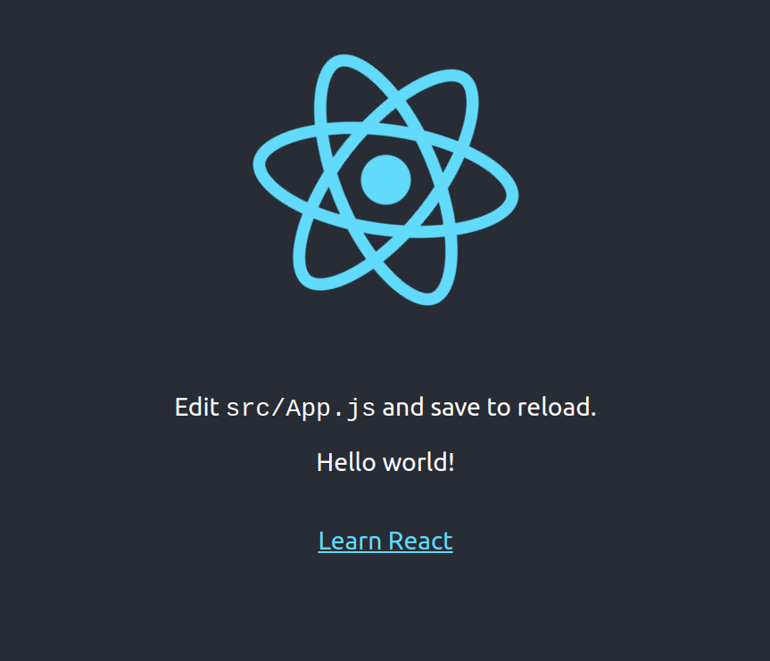

# Spring Boot + React Archetype

An archetype with Spring Boot + React

### Requirements:
- Java 19
- Maven
- Node 20
- npm 10

### Installation:

#### Backend:
To build the backend, run the following command:
```
> mvn clean install
```
#### Frontend:
To install the frontend dependencies, run:
```
> npm install
```

### Swagger Documentation
The API documentation is available via Swagger UI at [http://localhost:8080/swagger-ui/index.html](http://localhost:8080/swagger-ui/index.html). This interface allows you to explore and test the API endpoints defined in the application.

### Docker
To run the application using Docker, you can use Docker Compose. 
Make sure you have Docker and Docker Compose installed on your machine. 
This will start two containers: one for the frontend (React) on port 3000 and one for the backend (Spring Boot) on port 8080.

You can start the application with the following command:
```
> docker-compose up
```
This command will build the Docker images and start the containers defined in your `docker-compose.yml` file. Once the application is running, you can access the frontend at [http://localhost:3000](http://localhost:3000) and the backend at [http://localhost:8080](http://localhost:8080).

### Application Running
Once the application is running, you can visit [http://localhost:8080](http://localhost:8080). The "hello world!" message is returned from the backend as an endpoint call.

